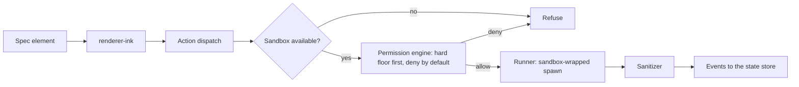

# Architecture

minitui is a terminal agent that builds small, single-purpose apps on demand. The model never emits code. It emits a
declarative spec that can only name components and actions from a frozen catalog, and every action with a side effect
passes a permission gate and runs inside an OS sandbox. This file is the structure and the rules that keep it that way.
It describes structure and rules, not status.

Each rule below says what enforces it: a gate (a file that fails the build) or "convention" (people and reviewers). A
convention that gets broken twice is a candidate for a gate.

## Packages

Thirteen `@minitui/*` packages and one private app. Twelve packages and the app exist today.

<!-- prettier-ignore -->
|Package|Job|May import|
|-|-|-|
|`types`|Shared contracts and value schemas|nothing internal|
|`sanitizer`|The one place terminal escape sequences are stripped|nothing internal|
|`transport`|Message bus, state store, snapshot deltas|types, sanitizer|
|`renderer-core`|The renderer port and the action-dispatch contracts|types|
|`catalog`|The frozen allowlist of components and actions; spec validation|types, renderer-core, sanitizer|
|`spec`|The declarative spec format, streaming compile, semantic checks|types, catalog|
|`agent-core`|The model loop; the only package that talks to the model SDK|types, transport, spec, sanitizer|
|`exec`|Shell parsing, the permission engine, the OS sandbox, the local runner and the action router|types, renderer-core, sanitizer|
|`renderer-ink`|The Ink implementation of the renderer port|types, renderer-core, catalog, sanitizer|
|`runtime-host`|Mounts a validated spec over the one shared store, routes the actions a renderer raises, relaunch re-bind of typed parameters|types, transport, spec, renderer-core|
|`test-kit` (private)|The shared test toolkit: a scripted model provider, a permission engine double, a tool registry, a headless host over the real Ink mount, golden helpers and the canonical merge fixtures. Never in a product bundle|types, spec, renderer-core, renderer-ink; its own tests also the catalog, `react` and `ink`|
|`apps/cli` (private app)|The `minitui` bin and the composition root: the one place that names concrete implementations and wires them into a host; boot detection, terminal restore and the log file|every runtime package, not test-kit or integration-tests|
|`integration-tests` (private, root `test/`)|The suites only a package that imports everything can run: the merge spine and the production composition end to end, the five cross-package security files, the render-local parity of the host and the renderer, and the pre-push gate list. Every suite runs in every test run; only the live sandbox row needs `RUN_E2E`|every package; no DAG zone|

Not built yet: `library` (types, spec).

The table follows `config/eslint-boundaries.js`. If they disagree, the config wins and this table is wrong.

## The three seams

1. **Renderer swap boundary.** `renderer-core` is the port, `renderer-ink` the implementation. Only `renderer-ink` and
   `cli` may import `ink`, `react` or `@json-render/ink`, so the terminal UI can be replaced without touching the rest.
   The one exception is test-kit's own tests, which may import `react` and `ink` by exact name to drive small Ink
   fixtures; its source may not. Enforced: `eslint.config.js` (restricted imports).
2. **No-code catalog seam.** The agent can only produce specs whose every element and action is in the catalog.
   Nothing it writes is executed as code. Enforced: spec and catalog validation and their tests.
3. **Exec moat.** Every command passes the host's own parse, the deny-first permission engine and the sandbox. Only
   `exec` may import `child_process`, the sandbox runtime or the MCP client; only `agent-core` may import the model
   SDK. Enforced: `eslint.config.js` (capability walls).

## One implementation, many callers

<!-- prettier-ignore -->
|Concern|Home|The rule|
|-|-|-|
|Stripping terminal escapes|`packages/sanitizer`|One strip path. No second one, no parser dependency. Enforced: it imports nothing internal.|
|Parsing a shell command|`packages/exec/src/permission/shell`|The host parses; the agent never does. Anything not modelled is denied. Convention, with security tests.|
|The hard floor|`packages/exec/src/permission/hard-floor.ts`|Secret reads, destructive removes of home or root, and network egress are refused even in the most permissive mode. Convention, with security tests.|
|Secret paths|`packages/exec/src/permission/secret-paths.ts`|One list, shared by the floor, the saved grants and the sandbox. Convention.|
|The sandboxed child's environment|`hardenChildEnv` in `packages/exec/src/sandbox/manager.ts`|An allowlist. Every spawn takes its environment from it. Convention, with tests.|
|Sandbox write and egress policy|`packages/exec/src/sandbox/config.ts`|Refuse a bad policy; never relax one. Convention, with tests.|
|Running a local process|`packages/exec/src/exec/local-runner.ts`|The one wrap site: every spawn is sandbox-wrapped, runs in its own process group, takes its environment from the wrap and reports its end back to the sandbox. Convention, with tests.|
|Running an action|`packages/exec/src/dispatch/router.ts`|The only public way to run an action: the sandbox guard, then the real path of the merge output's directory, then the permission engine, then the handler. The per-kind handlers stay internal. Enforced for the public names: `packages/exec/test/surface.test.ts`.|
|Reading the merge slots|`readMergeSlots` in `packages/exec/src/permission/resolve-request.ts`|One reader of the merge parameters, used for the consent text and for the run, so the two cannot describe different commands. Convention, with tests.|
|Text of a fault|`boundFaultText` in `packages/exec/src/dispatch/exec-local-handler.ts`|Every fault text exec builds is stripped of escapes and windowed here. Convention, with tests.|
|The output file of a merge|`packages/exec/src/dispatch/output-file.ts`|The host makes the empty output exclusively and holds it open for the run; one finisher closes it and, for a run that did not settle, removes it if the path still names the same file when the finisher checks. Convention, with tests.|
|The real path of the merge output|`packages/exec/src/dispatch/resolve-output.ts`|The router takes the real path of the output's directory before the permission gate, after the spelling it was given has passed the path rules and the hard floor, so the consent text, the engine's floor, the host-side create and the command name one path, and a refusal of the typed spelling stands. A directory that cannot be resolved is refused before the prompt. Operator rules and saved exact grants are matched against the real path, and an argument-shape ask is judged on the path ffmpeg receives. Convention, with tests.|
|The consent values of a gated action|`packages/runtime-host/src/dispatcher.ts`|The host router takes the kind and the permission descriptor of an action from the catalog, not from the renderer's context, refuses a context that disagrees, and reads the value of every root named by either template of the descriptor from the live state, so the consent box shows host values. A root with no live value is refused. Convention, with tests. The host itself leaves a key that no template names (the local merge's `mode`) as the renderer sent it; the parameter check it is given, catalog's `hostCatalogDeps` (`packages/catalog/src/host-deps.ts`, used by the cli and by the integration package), refuses any key outside the action's schema, so such a key is refused for every renderer.|
|The render-local actions|`packages/runtime-host/src/dispatcher.ts` (`RENDER_LOCAL_ACTIONS`); the renderer-ink binder holds its own list (`RENDER_LOCAL_ALLOWLIST`)|`setState`, `pushState` and `removeState` only, with json-render's parameter shapes. The host cannot import renderer-ink, so `test/conformance/render-local-parity.test.ts` checks the two lists across the packages: they are equal, each name writes state through the host, and the host refuses `log` and `exit` even when told they are local. Enforced by that test.|
|Restoring the terminal and the log file|`apps/cli/src/boot.ts`|One registration restores the cursor and the alternate screen on the exit event, on a terminating signal (re-raised afterwards) and on a crash, exactly once; the text of a crash reaches stderr only through an injected sanitising formatter. The log file is created with 0600 permissions, any filesystem error gives a writer that does nothing, and the diagnostics sink scrubs every finished line. Convention, with tests.|
|The consent answer|`apps/cli/src/consent.ts`|The overlay shows one request at a time, the oldest the engine surfaced, and every reply names that request's id, so an answer can never approve a later request; the rejection feedback is written by the host, never by the agent. Convention, with tests.|
|The consent answer in tests|`packages/test-kit/src/tools/test-consent-controller.ts`|The twin of the cli's consent controller for tests, which cannot import the cli: the same order (the oldest request first) and the same replies by request id. A change to one is made to the other. Convention, with tests.|
|Configuration layers|`apps/cli/src/config.ts`|Layers merge by a fixed precedence. The keys that redirect credentials, execution or telemetry are stripped from any layer that is not trusted, whatever their spelling or the layer's rank. Convention, with tests.|
|Secrets in what the program writes|`apps/cli/src/index.ts`|The API key reaches only the provider. Every finished log line, every crash line and every message to the person goes through one cleaner that removes the key and the terminal control characters, and the redaction policy handed to the session and the provider carries a pattern for the key, so it is removed from text on its way to the model too. Convention, with tests.|

## Rules

1. **Imports follow the table, with no cycles.** Enforced: `import/no-restricted-paths` in `eslint.config.js` and
   `config/eslint-boundaries.js`; the composite `tsc -b` build is a second cycle detector.
2. **A package is used only through its barrel.** Each `package.json` exports `.` and nothing else, so a deep import
   does not resolve. Enforced: the `exports` field of each package.
3. **Fail closed.** An unsupported OS, a missing sandbox runtime or an unparsed command ends in a refusal. A gated
   command is never run unsandboxed. Convention, with a security suite.
4. **Consent shows host-resolved values**, never text the agent wrote. Convention, with a security suite.
5. **Concrete implementations are named in one place**, the composition root in `apps/cli`. Packages depend on ports.
   Convention.
6. **Tests use real implementations.** A test double is a real implementation of the port, injected through the
   production seam. No `vi.mock`, no `vi.spyOn`, no `@ts-ignore`, no `as never` and no cast through `unknown`. Enforced:
   the test-file rules in `eslint.config.js` and `config/eslint-policy.js`, which also cover test-kit's source (the
   doubles other packages' tests import), counted by `scripts/lint-test-policy.mjs`.
   Any other cast that hides a type gap is caught in review.
7. **A gate must be able to fail.** Each lint rule that guards a boundary has a planted violation that must be
   reported. Enforced: `scripts/check-eslint-policy-fixtures.mjs`.
8. **Committed files explain the code in plain words.** They carry no references to working documents and no
   tracking ids. Enforced: `scripts/check-outbound-trace.mjs`. Tool and model names stay out by convention, with a
   manual check before each commit.
9. **Function complexity is at most 15.** Enforced: the `complexity` rule in `eslint.config.js`.
10. **Files stay small:** 200 to 400 lines typical, 800 at most, one responsibility each. Convention. No gate yet.
11. **Shared dependencies have one version.** Versions are declared once in the workspace catalog and packages
    reference `catalog:`. Enforced for the shared set (react, ink, zod, typescript, the parser) and for internal
    packages (workspace protocol): `.syncpackrc.json`. The catalog habit itself is convention.
12. **Tests are deterministic.** The clock, timezone, locale and terminal-size variables are frozen for every test.
    Enforced: `vitest.determinism.setup.ts`.
13. **Coverage floor:** 85% statements and lines, 80% branches and functions, in aggregate. Enforced:
    `vitest.shared.ts`. The coverage step leaves out each package's `test/surface.test.ts`: those tests build
    a TypeScript program and import nothing from `src` at run time. `apps/cli` is outside the coverage `include` (packages
    only); its tests run in the test and coverage steps. Convention.
14. **Adopt, do not rebuild.** Use the adopted libraries for what they do; build only the permission and sandbox core.
    Convention.
15. **Handle errors at boundaries** (user input, the model API, process execution, MCP, I/O), not around calls between
    trusted modules. Convention.
16. **A structural change updates this file in the same change.** A new package, a new import edge, a new seam or a new
    single implementation edits the tables above. Convention.

## What runs before code is accepted

The pre-commit hook runs the type check, format, test policy and lint, plus syncpack when a manifest changes. The
pre-push hook (`lefthook.yml`) runs ten
steps in order, cheapest first, and stops at the first failure: syncpack, format, policy fixtures, build, lint, type
check, composite type check, tests, coverage, and the pack check that installs each published tarball into a throwaway
consumer.

## One action, end to end

The README's status table says which of these links exist today.
