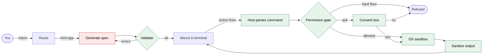

# minitui

[](https://github.com/erkin98/minitui/actions/workflows/ci.yml)


**A terminal agent that builds small, single-purpose apps on demand, and runs them behind a permission gate and an OS sandbox.**

You say what you want: _merge these two videos_, _rename every file by its EXIF date_. minitui does not paste a wall of shell at you, and it does not run code a model wrote. It assembles a small interactive form from a fixed, trusted catalog of components, draws it in your terminal, and runs the commands behind it only after the host has parsed them, checked them against a deny-first permission engine, and wrapped them in a sandbox.

> **Pre-release.** The core packages are implemented and tested, but the pieces that tie them into a runnable program (the session host, the kept-app library and the CLI) are not built yet. There is nothing to install today. See [Status](#status).

## Why

Two ways of letting a model touch your machine, and both are bad:

- **Generated shell** is opaque. Nobody reads a forty-flag `ffmpeg` line before pressing enter.
- **Generated code** is unbounded. A script the model wrote can do anything the model, or whoever prompted it, wants.

minitui takes a third route. The model never emits code. It emits a _declarative spec_ that can only name components and actions from a frozen catalog. The model proposes, and the host decides: the host parses the real command, shows you the resolved text (never the model's description of it), and enforces the policy.

## What a run looks like



The red node is the only place the model's output enters. Everything after it is host code. This is the design; steps 3 to 5 exist as packages today, while routing, running and keeping are planned (see [Status](#status)).

1. **Route** (planned). Your intent is classified as a quick answer, a one-shot command, or a generated mini-app.
2. **Generate.** For an app, the model streams a spec. Every element and action in it must exist in the catalog allowlist.
3. **Validate.** The spec is checked structurally and semantically (do the bindings resolve, is the named state real) with a repair-and-retry loop before anything is drawn.
4. **Render.** The validated spec mounts as an interactive terminal UI.
5. **Gate and run.** When an action fires, the host parses the command itself, splits compound commands, refuses opaque substitution, and resolves the result against the permission engine. Approved commands run inside an OS sandbox. Output has its terminal control sequences stripped before it reaches the screen.
6. **Keep** (planned). Apps worth keeping can be saved and relaunched, re-binding their parameters on the way back in.

### The consent box

When the engine cannot decide on its own, the host draws this over the app and hides the app until you answer. The structure (headline, resolved command, affected paths, key line) and the key line itself are real; the wording of the other lines is illustrative.

```text
╔══════════════════════════════════════════════════════════════╗
║ Run this command on your machine?                            ║
║                                                              ║
║ ffmpeg -i 'intro.mp4' -i 'clip 2.mp4' -filter_complex        ║
║ 'concat=n=2:v=1:a=1' 'merged.mp4'                            ║
║                                                              ║
║ reads  ./intro.mp4  ./clip 2.mp4                             ║
║ writes ./merged.mp4                                          ║
║                                                              ║
║ Allow? [a]lways / [y]es / [n]o (Esc denies)                  ║
╚══════════════════════════════════════════════════════════════╝
```

The command is the host's own resolved, shell-quoted text. Characters that could disguise it (control characters, invisible and bidirectional formatting) are replaced with U+FFFD rather than drawn. If the request does not fit on the screen, it cannot be allowed, only denied. `always` is a narrow, session-only grant.

## Security model

<!-- prettier-ignore -->
| Guarantee | Where it is enforced |
|-|-|
| The model cannot introduce code, only catalog elements and actions. | `catalog` allowlist, plus the structural and semantic checks in `spec`. |
| The host, not the model, parses every shell command. Anything the parser does not model is denied. | `exec`: tree-sitter-bash with a positive allowlist of syntax node kinds. |
| Decisions are deny-first, and a hard floor cannot be overridden, even in the most permissive approval mode: network-fetch tools, `rm` of `$HOME` or `/`, and reads of secret files. | `exec` permission engine. |
| The consent box shows host-resolved values, never agent-written text, and a request that cannot be shown whole or holds invisible characters is denied. Tying the approved text to the argv that is spawned is the command runner's job (planned). | `exec` canonical-request check, `renderer-ink` overlay. |
| Terminal output cannot drive your terminal. Escape and control sequences are stripped at a single chokepoint. | `sanitizer`, a zero-dependency leaf package. |
| The sandbox is designed to fail closed. The probe reports "unsupported" when the runtime is missing or fails to load; refusing every gated command on that signal belongs to the sandbox surface (planned). | `exec` sandbox probe, built on sandbox-runtime. |
| Local actions in a mini-app can only change app state. They cannot log, exit, or run commands. | A state-only allowlist in the renderer boundary. |
| Layering cannot silently erode. | Import-boundary lint at error level plus composite `tsc -b`, both in CI. |

### What it does not claim

- **Interpreters and `find`.** The engine cannot model what `python -c` or `find -exec` will do, so it never lifts an ask for them, and the promise rests on the sandbox.
- **The floor is a list, not a proof.** It names the common secret files, key types and network tools, and it reads the text of a command. Equivalent spellings it does not name are caught only by the sandbox, which is why the sandbox is the control and the floor is a second layer.
- **Platforms.** Linux and macOS are the targets. Windows is not supported. The design is that gated execution refuses to run there; that refusal is part of the planned sandbox surface and is not in the built code yet. No macOS run has been recorded.
- **End to end.** Each guarantee above is tested at its own boundary. A full session that generates a spec, asks, wraps and runs a command in a live sandbox on real hardware has not been exercised yet, because the host that connects the pieces does not exist yet.

## Architecture

A pnpm and Turborepo monorepo. Dependencies point one way, and the build enforces it.

<!-- prettier-ignore -->
| Package | Role | State |
|-|-|-|
| `@minitui/types` | Shared schemas and value types. | built |
| `@minitui/sanitizer` | The single strip for terminal control sequences. No dependencies. | built |
| `@minitui/transport` | The ports between the model loop and everything else, with a local adapter. | built |
| `@minitui/agent-core` | The model loop: streaming, retries, abort, loop guards, event stream. | built |
| `@minitui/spec` | Streaming spec parse, structural and semantic validation, repair loop. | built |
| `@minitui/catalog` | The frozen component and action allowlist, and the prompt derived from it. | built |
| `@minitui/renderer-core` | The renderer port. No UI framework appears in its signature. | built |
| `@minitui/renderer-ink` | The Ink implementation of that port, including the consent overlay. | built |
| `@minitui/exec` | Shell parsing, permission engine, hard floor, grants store, sandbox probe and wrapper. The command runner and the rest of the sandbox surface are planned. | partly built |
| `@minitui/runtime-host` | Wires a session together and owns its lifecycle. | planned |
| `@minitui/library` | Saving and relaunching kept apps. | planned |
| `@minitui/cli` | The `minitui` command. | planned |
| `@minitui/test-kit`, `@minitui/integration-tests` | Shared harnesses, and end-to-end suites across all packages. | planned |

Two seams and one moat:

- **The renderer swap boundary.** Only `renderer-ink` and the CLI may import `ink` or `react`. The rendering backend can change without touching the core.
- **The no-code catalog seam.** The spec layer and the catalog are the only way the model's output reaches the screen.
- **The exec moat.** Only `exec` may spawn processes or talk to tool servers. Only `agent-core` may import the model SDK.

## Built with

TypeScript (strict, with `exactOptionalPropertyTypes` and `noUncheckedIndexedAccess`) on Node, [Ink](https://github.com/vadimdemedes/ink) and [json-render](https://github.com/vercel-labs/json-render) for terminal rendering, the [Vercel AI SDK](https://ai-sdk.dev) for the model loop, [web-tree-sitter](https://github.com/tree-sitter/tree-sitter) with the bash grammar for command parsing, [sandbox-runtime](https://github.com/anthropic-experimental/sandbox-runtime) for the OS sandbox, and the Model Context Protocol client for lazily attached tool servers. Library versions are pinned once, exactly, in one catalog.

## Engineering practices

- **No test mocks.** A test double is a real implementation of the port, injected through the same seam production uses. A lint gate rejects module mocks, spies, `@ts-ignore`, and casts that hide a type gap.
- **Every gate has a case that proves it can fail.** Boundary lint ships with planted violations. The security suites carry controls that must go red when the protection is removed.
- **Packed tarballs are installed and imported** from a clean consumer (`pnpm pack:check`). Two packages, `agent-core` and `exec`, are not covered yet.
- **Supply chain.** Exact versions only, a seven-day quarantine on freshly published releases, no unvetted install scripts, no lockfile downgrades.
- **Deterministic snapshots.** Terminal golden tests run with a frozen clock and a fixed 80x24 screen.

## Status

<!-- prettier-ignore -->
| Area | State |
|-|-|
| Nine core packages | Implemented, with unit and boundary tests. Type checks, lint and tests pass locally. `exec` is partial, as above. |
| Session host, kept-app library, CLI | Not built. You cannot run minitui yet. |
| Live model traffic | Not exercised. The model loop is tested against an in-process provider. |
| Real sandbox session on Linux, run on macOS | Not exercised end to end. |
| Releases | None. The workspace is private and unpublished. |

Expect breaking changes until the first release.

## Working in the repo

You need Node 22.13 or newer and pnpm 11 (the exact version is pinned in `package.json`).

```bash
pnpm install
pnpm build          # turbo build, all packages
pnpm test           # per-package tests plus the root project
pnpm lint           # eslint, import boundaries, test policy, outbound-text scan
pnpm typecheck      # per-package tsc --noEmit
pnpm typecheck:tsc  # tsc -b, the composite build
```

`pnpm test:all` runs the whole suite in one pass. `pnpm pack:check` builds every package, packs it, and imports the tarball from a clean consumer. Git hooks are installed by `pnpm install` and run the main checks before a commit or a push.

## License

Apache License 2.0. See [LICENSE](LICENSE).
